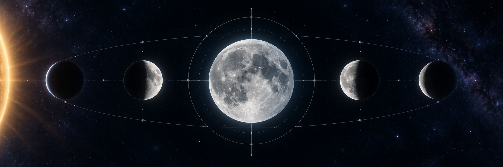

# Lunar Phases

<p align="center">
  
</p>

<p align="center">
  A compact, dependency-free C11 command-line tool for exploring the Moon's position, illumination, and phase times.
</p>

Lunar Phases turns a date—or the current time—into a readable astronomical snapshot. It also calculates the exact UTC or local times of the four principal lunar phases for a given year.

## Highlights

- Calculates the current phase, illuminated fraction, Moon age, elongation, and phase angle.
- Reports ecliptic coordinates, Earth–Moon distance, angular diameter, and the Sun's ecliptic longitude.
- Solves new moon, first quarter, full moon, and last quarter times with Newton refinement.
- Uses Julian dates, a truncated ELP-2000/82 lunar model, apparent solar longitude, nutation, and an Espenak–Meeus ΔT approximation.
- Builds with standard C11 and links only against the system math library.
- Installs a reusable `lunar_core` library with public headers and CMake package metadata.
- Includes deterministic unit/regression tests, sanitizer support, and GitHub Actions CI on Linux and macOS.

## Quick start

Requirements: CMake 3.16 or newer, a C11 compiler, and a POSIX-like shell.

```sh
cmake -S . -B build
cmake --build build
ctest --test-dir build --output-on-failure
```

Then inspect the current sky state:

```sh
./build/lunar_phases
```

## Usage

With no arguments, the program uses the current system time. A date can be supplied as `YEAR MONTH DAY`, with optional hour, minute, and second:

```sh
./build/lunar_phases 2026 10 25 12 30 00
```

To list every principal phase in a year:

```sh
./build/lunar_phases phases 2026
```

Dates are interpreted as UTC by default. Set `TIMEZONE_OFFSET_HOURS` to display results in a fixed local offset:

```sh
TIMEZONE_OFFSET_HOURS=-3 ./build/lunar_phases phases 2026
```

The output is intentionally plain text, making it useful in shell scripts, cron jobs, and quick astronomical experiments.

## Development

Run the complete test suite:

```sh
make test
```

Run the suite with AddressSanitizer and UndefinedBehaviorSanitizer:

```sh
cmake -S . -B build-sanitize -DLUNAR_ENABLE_SANITIZERS=ON
cmake --build build-sanitize
ctest --test-dir build-sanitize --output-on-failure
```

Install the executable and public headers locally:

```sh
cmake --install build --prefix "$HOME/.local"
```

The same install contains the `lunar_core` static library and can be consumed from
another CMake project:

```cmake
find_package(LunarPhases CONFIG REQUIRED)
target_link_libraries(your_target PRIVATE LunarPhases::lunar_core)
```

## Browser / WebAssembly package

The `wasm/` directory provides a client-side JavaScript API backed by the same
astronomy core. See [wasm/README.md](wasm/README.md) for browser usage and the
`npm run build` command that produces the WebAssembly module and ESM bindings.

GitHub Releases publish an archive for Linux, Windows, and macOS containing the
CLI, library, headers, and CMake package files.

## Project layout

| Path | Purpose |
| --- | --- |
| `include/` | Public C headers for calendar, astronomy, and phase calculations |
| `src/` | Julian-date conversion, lunar/solar model, phase solver, and CLI |
| `tests/` | Deterministic reference and bounds tests |
| `cmake/` | CMake package configuration used by downstream projects |
| `art/` | Project artwork used by the documentation |
| `.github/workflows/` | Build, test, sanitizer, and release workflows |

## Accuracy and scope

The implementation is based on Jean Meeus' *Astronomical Algorithms* and is designed for educational, planning, and general-purpose use. Phase times are expected to be accurate to roughly one minute between 1800 and 2150. Outside that range, results are approximate; the ΔT calculation is intentionally simplified.

This is not a replacement for a high-precision ephemeris library or an observatory-grade time service.

## Contributing

Corrections to the astronomical model, portability improvements, tests, and documentation updates are welcome. See [CONTRIBUTING.md](CONTRIBUTING.md) before submitting a change.

Lunar Phases is free software released under the [MIT License](LICENSE).

